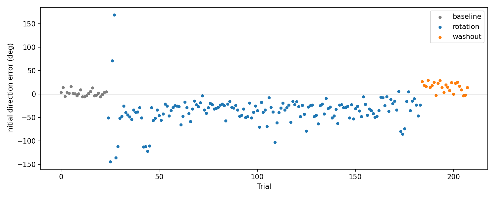

# Visuomotor Rotation Reaching Task

A small motor-learning experiment in Python: a centre-out reaching task with a 45° visuomotor rotation, run with a mouse. It was built as a first hands-on look at how people adapt their movements to a perturbation.

## Task

- Move the cursor into the start circle and hold for 0.5 s.
- A target appears in one of 8 directions (300 px away). Reach to it as fast and straight as you can.
- 208 trials in three phases:

| Phase | Trials | Cursor |
|---|---|---|
| Baseline | 24 | normal |
| Rotation | 160 | rotated 45° clockwise |
| Washout | 24 | normal |

During the rotation phase the hand has to move 45° counter-clockwise from the target direction for the cursor to go straight to the target.

## Run

```
pip install pygame numpy pandas matplotlib
python reach_task.py     # collects data into data/ (ESC to quit)
python analysis.py       # initial direction error per trial -> learning_curve.png
```

`analysis.py` reads the session files named at the top of the script; update the session id there to analyse a different run.

## Data

- `data/trials_<session>.csv`: one row per trial (phase, target angle, reaction time, movement time)
- `data/samples_<session>.csv`: one row per frame (time, raw mouse position, displayed cursor position)
- `data/discarded/`: an earlier test run and a first session in which no adaptation occurred (kept for transparency, not analysed)

## Result (single pilot session, n = 1)

Initial direction error is the angle between the cursor's direction when it first passes 60 px from the start and the target direction.



| Phase | Median initial direction error |
|---|---|
| Rotation, first 20 trials | about -48° |
| Rotation, last 20 trials | about -22° |
| Washout, first 5 trials | about +19° |
| Washout, last 5 trials | about +9° |

- Adaptation was partial: the error shrank but did not reach 0° within 160 trials.
- The positive error at the start of washout is an aftereffect.
- A few outlier trials at the start of the rotation phase reflect early, exploratory movements, so medians are used.

## Limitations and next steps

Single participant and a single session, so this is a pilot rather than a result. Planned extensions: whole-trajectory analysis beyond initial direction error (e.g. autoencoders or recurrent networks), and more participants.
